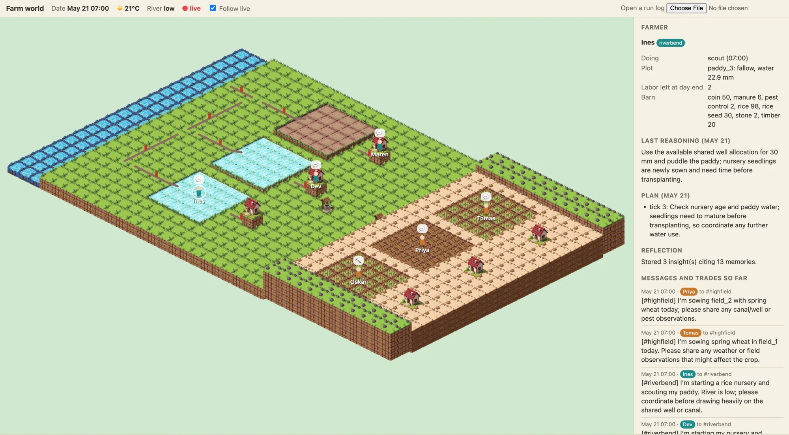

# World Simulation

Simulated worlds where independent AI agents act on real, Python-owned rules. In each world the simulator decides what actually happens; agents see only their own observations, talk to each other, and have to work out whom and what to trust. Each world lives under `worlds/`.

| World | What it is | Docs |
| --- | --- | --- |
| [Station Control](worlds/station/) | A space station crew keeps life support running while equipment fails, sensors drift, and reports mislead. Adds multi-world trade, delayed deception, and talking agents with memory and an adversary that lies through fronts. | [README](worlds/station/README.md) |
| [Farm world](worlds/farm/) | Rice paddies and wheat fields run by six farmer agents in two communities, on real agronomy and weather. | [Actions](worlds/farm/ACTIONS.md) · [Run it](AGENTS.md#farm-world) |

## Station Control

The first world tests how an AI crew keeps a space station operational when things go wrong, with a captain, an optional Jev classifier, scenarios, and an AI adversary. It has an offline rules controller, replayable mission logs, and an [interactive architecture explorer](https://felixglush.github.io/world-simulation/). Start with the [Station Control README](worlds/station/README.md).

## Farm world

Two communities, Riverbend (rice) and Highfield (wheat), each have three independent farmer agents who start with seed, food, manure and a plot. Nobody assigns roles or a leader, so water sharing and any organization has to emerge from what the farmers say and do. Python owns the agronomy: paddy puddling, standing water, bunds, gravity-fed canals and gates on terraces, the monsoon river, wheat vernalization, waterlogging, pests, and post-harvest drying, threshing and milling. Farmers can build, trade and gift. The viewer, shown above, follows a run log live and shows each farmer's last reasoning, plan, reflection, and messages.

### What the farmers did

Findings from the one substantial live run in `runs/` (25 days from day 140, seed 1, 6 farmers, about 450 model decisions). Two earlier runs produced no decisions because every call failed. Treat this as one anecdotal run, not a benchmark: the log header does not record the models, and the run contains no building or trade actions.

- **They talk a lot, mostly inside their own community.** 212 messages: 180 from the rice farmers and 32 from the wheat farmers. 181 went to a community channel, and the rest were direct messages between neighbours. Nothing crossed between Riverbend and Highfield.
- **Water created the talk.** Riverbend shares a canal and a well, so its farmers announced pumping and gate changes, asked each other to keep routes open, and told a neighbour to cancel a queued top-up the paddy no longer needed. Highfield has no shared water, so its wheat farmers mostly reported their own field and promised to keep monitoring.
- **Coordination was polite and informal.** The farmers announced intentions, thanked each other and held back from drawing shared well water when their own paddy had enough. The messages contain no schedules, rotations, or disputes.
- **They are cautious.** Scouting (248) and resting (171) made up over a third of the 1,130 actions. Farming work was rarer: 67 weedings, 18 pumpings, 15 gate changes, 11 fertilizings, and a handful each of tilling, sowing, puddling and transplanting.
- **Most mistakes were about timing.** 36 actions were rejected by the world, and 21 of those were waiting-time or quantity mistakes, such as transplanting seedlings at 17 days when 18 are needed, puddling with 23 mm of water when 30 is needed, or sowing 1 kg of seed when the minimum is 20. They often retried the same action anyway: one farmer was refused four times for transplanting 17-day-old seedlings.
- **Rice farm health fell and the farmers could not say why.** Over the run the three paddies slipped from 0.77 to 0.72-0.75 while the wheat fields rose to about 0.80. The rice farmers noticed yellowing despite ample water, scouted for pests, weeds and low nitrogen, found none, and said so to each other instead of guessing a cause or applying a speculative treatment.
- **Models were woken more by chat than by events.** Of 487 reviews, 264 were triggered by an incoming message and 401 by the idle timer. Only 78 were triggered by new evidence from the world.

See [AGENTS.md](AGENTS.md#farm-world) to run it and [ACTIONS.md](worlds/farm/ACTIONS.md) for everything a farmer can do.

## Development

[AGENTS.md](AGENTS.md) has setup, run commands, and checks. [architecture/README.md](architecture/README.md) covers the architecture explorer.
